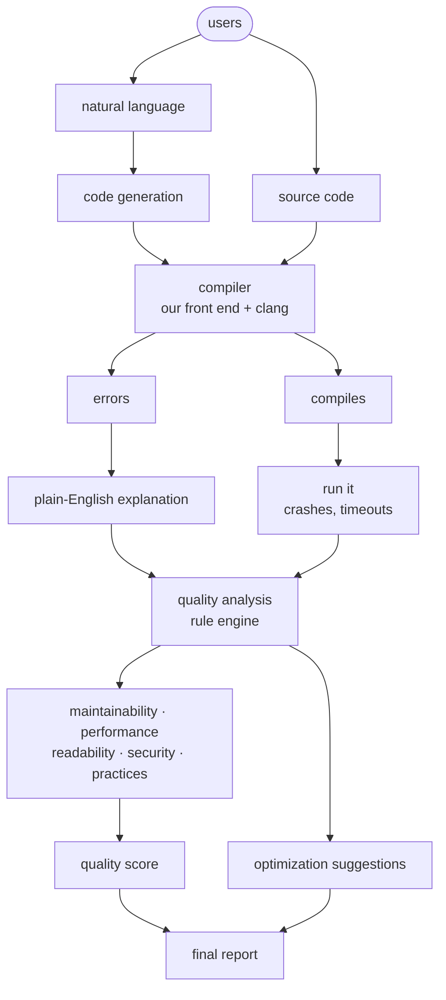

# How it works

What the code actually does, box for box.

## Which module is which box

| Box | Module |
|---|---|
| code generation | `nlpcc/generate.py` |
| compiler | `nlpcc/frontend/` + `nlpcc/backends/clang_runner.py` |
| run it | `nlpcc/backends/executor.py` |
| plain-English explanation | `nlpcc/explain/` |
| quality analysis, the five dimensions | `nlpcc/quality/rules.py` |
| quality score | `nlpcc/quality/score.py` |
| optimization suggestions | `nlpcc/optimize/` |
| final report | `nlpcc/report/` |

## Three differences from the original slide

1. **The analysis stage is rules, not AI.** Every deduction names a threshold,
   so a score can be explained and repeated. The model is used in two places
   only: generating code, and explaining a diagnostic no rule covers.
2. **Optimization comes off the findings, not off the score.** "Flatten this
   nesting" does not need a number computed first. The report still prints
   them in the original order.
3. **clang runs beside our own front end.** Ours reports the finding; clang
   is the check that we did not miss one.
